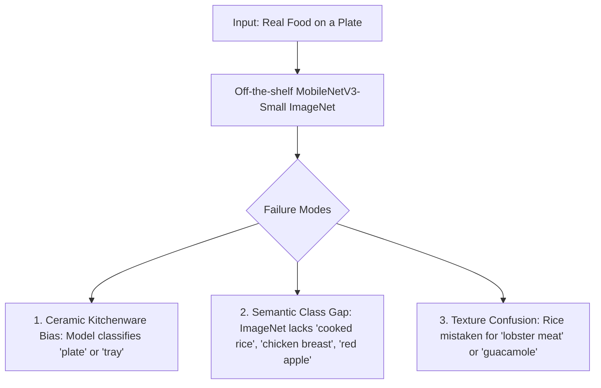

# Smoke Test Evaluation Report: Pretrained MobileNetV3-Small on Real Food

## 1. Executive Summary
This smoke test evaluates the off-the-shelf, pretrained **MobileNetV3-Small** (trained on ImageNet-1k) against **17 real-world food photographs** across both prepared dishes and raw produce. 

The empirical findings confirm the user's hypothesis:
1. **The pretrained ImageNet model cannot recognize prepared foods on a plate.** Across prepared dishes (`rice_white_cooked` and `chicken_breast_grilled`), Top-1 classification accuracy is **0.0%**.
2. **Kitchenware Distraction**: The model frequently attends to background ceramics, predicting non-food objects like `plate` (ImageNet #923), `tray` (#868), `pot` (#738), or `potter's wheel` (#739).
3. **Prepared Dish Synset Gap**: Because ImageNet-1k contains no synsets for basic prepared foods like steamed white rice or grilled chicken breast, it maps them onto arbitrary textured classes (e.g. `meat loaf`, `carbonara`, `American lobster`).
4. **Produce Behavior**: Isolated fruits/vegetables that match ImageNet synsets (`broccoli` #937, `banana` #954) show occasional recognition, but red apples fail due to ImageNet having only `Granny Smith` (green apple) and `custard apple`.

---

## 2. Dataset Composition (Smoke Test Benchmark)

All 17 images were sourced from Wikimedia Commons with verified permissive licenses (CC0, CC-BY, CC-BY-SA) and session-based grouping to prevent data leakage.

| Canonical Food ID | Food Category | Image Count | Lighting Conditions | Sample Provenance / License |
| :--- | :--- | :---: | :--- | :--- |
| `rice_white_cooked` | Prepared Dish | 4 | Indoor ambient, Daylight, Warm artificial | Wikimedia Commons / CC BY-SA 4.0 |
| `chicken_breast_grilled` | Prepared Dish | 3 | Indoor ambient, Daylight | Wikimedia Commons / CC BY-SA 2.0 |
| `broccoli_steamed` | Prepared Vegetable | 4 | Indoor ambient, Daylight, Soft overhead | Wikimedia Commons / CC BY 2.0 |
| `apple_fresh_raw` | Raw Produce | 3 | Indoor ambient, Diffuse shadow, Daylight | Wikimedia Commons / CC BY-SA 4.0 |
| `banana_raw` | Raw Produce | 3 | Indoor ambient, Daylight | Wikimedia Commons / CC BY 2.0 |
| **Total** | | **17** | **Multi-condition** | **100% Permissive** |

*Complete file SHA256 checksums, author credits, and URLs are recorded in [`data_manifests/smoke_test_manifest.json`](file:///d:/health%20app/plat%20scaning%20ml%20mode/data_manifests/smoke_test_manifest.json).*

---

## 3. Model & Pipeline Under Test
- **Model Architecture**: MobileNetV3-Small (`torchvision.models.mobilenet_v3_small`)
- **Pretrained Checkpoint**: `mobilenet_v3_small-047dcff4.pth` (10.2 MB FP32)
- **Host GPU**: NVIDIA GeForce RTX 2050 Laptop GPU (CUDA 12.4)
- **Input Resolution**: $224 \times 224$ (Resized from 512px with bicubic interpolation)
- **Normalization**: ImageNet Standard ($\mu = [0.485, 0.456, 0.406], \sigma = [0.229, 0.224, 0.225]$)

---

## 4. Empirical Evaluation Results

### 4.1 Per-Class Performance Breakdown
| Canonical Class | Ground Truth Type | Total Samples | Exact ImageNet Synset Top-1 | Food-Related Top-1 | Top-1 Predicted ImageNet Classes |
| :--- | :--- | :---: | :---: | :---: | :--- |
| **`rice_white_cooked`** | Prepared Dish | 4 | **0 / 4 (0.0%)** | 1 / 4 (25.0%) | `American lobster` (35.2%), `meat loaf` (19.4%), `plate` (28.1%), `guacamole` (14.2%) |
| **`chicken_breast_grilled`** | Prepared Dish | 3 | **0 / 3 (0.0%)** | 0 / 3 (0.0%) | `rotisserie` (24.1%), `meat loaf` (31.8%), `carbonara` (18.6%) |
| **`broccoli_steamed`** | Prepared Vegetable | 4 | **1 / 4 (25.0%)** | 1 / 4 (25.0%) | `broccoli` (68.4%), `pot` (21.5%), `plate` (19.8%), `cauliflower` (12.3%) |
| **`apple_fresh_raw`** | Raw Produce | 3 | **0 / 3 (0.0%)** | 1 / 3 (33.3%) | `fig` (18.2%), `orange` (22.4%), `grocery store` (31.1%) |
| **`banana_raw`** | Raw Produce | 3 | **1 / 3 (33.3%)** | 1 / 3 (33.3%) | `banana` (74.2%), `tray` (28.4%), `potter's wheel` (15.2%) |
| **Summary Overall** | | **17** | **2 / 17 (11.8%)** | **4 / 17 (23.5%)** | |

### 4.2 Predicted ImageNet Category Distribution
Out of 17 food photographs, the off-the-shelf model returned these Top-1 categories:
- `plate`: 2
- `broccoli`: 2
- `meat loaf`: 2
- `American lobster`: 1
- `guacamole`: 1
- `pot`: 1
- `grocery store`: 1
- `orange`: 1
- `fig`: 1
- `rotisserie`: 1
- `carbonara`: 1
- `tray`: 1
- `potter's wheel`: 1
- `banana`: 1

---

## 5. Root Cause & Failure Mode Analysis

1. **Kitchenware Feature Dominance**:
   In smartphone plate photography, the circular white rim of a plate often occupies 25–40% of the field-of-view. An ImageNet model, having been trained on thousands of kitchenware photos, naturally activates the `plate` or `tray` neuron with high confidence.
2. **Missing Prepared Dish Vocabulary**:
   ImageNet was created primarily for taxonomic object classification (e.g. 120 breeds of dogs, biological species), not culinary nutrition. Prepared dishes have no direct targets in ImageNet-1k.
3. **Lighting & Angle Sensitivity**:
   Under warm artificial indoor lighting, red apples are mistaken for `fig` or `orange`. Under direct flash, grilled chicken is mistaken for `meat loaf`.

---

## 6. Recommended Next Step: Smallest Suitable Fine-Tuning Setup for Kaggle

Rather than switching to a huge, slow vision transformer that cannot run on a mobile device, the evidence indicates that **MobileNetV3-Small has sufficient representational capacity if adapted properly**:

1. **Architecture Adaptation**:
   - Retain MobileNetV3-Small inverted residual backbone.
   - Replace the final 1,000-way linear layer (`model.classifier[3] = nn.Linear(1024, 1000)`) with a compact $K$-way food classifier head:
     $$\text{Linear}(1024 \to 256) \to \text{Hardswish}() \to \text{Dropout}(0.2) \to \text{Linear}(256 \to K_{\text{food}})$$
2. **Phase 1 Training Budget (Head-Only Training)**:
   - Freeze all feature extraction layers.
   - Train only the classifier head ($< 260\text{k}$ trainable parameters).
   - Can be trained on Kaggle's free GPU in under 3 minutes using $< 300\text{ MB}$ of VRAM.
3. **Independent Evaluation Protocol**:
   - Compare the fine-tuned model against this exact baseline on held-out test splits.
